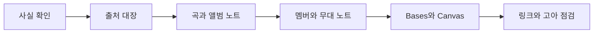

# 볼트 설계

리센느 볼트를 만들면서 정한 규칙을 적어 둔 노트다. 새 노트를 추가하는 사람은 이 규칙을 따른다.

## 개요

목표는 두 가지다. 하나는 실제로 공개해도 사람들이 와서 읽을 수 있는 덕질 위키다. 다른 하나는 옵시디언의 노트, 링크, 백링크, 속성, Bases, Canvas, 그래프 뷰를 눈으로 보여 주는 교재다. 시작점은 [[리센느]]다.

## 폴더

| 폴더 | 들어가는 노트 | 그래프 색 |
|---|---|---|
| `00 대문` | [[리센느]], 이 노트, [[둘러보기 길잡이]] | 노랑 |
| `10 멤버` | 멤버 노트, `멤버.base` | 산호 |
| `20 디스코그래피/앨범` | 앨범 노트 | 파랑 |
| `20 디스코그래피/곡` | 곡 노트 | 하늘 |
| `30 무대와 콘텐츠` | 콘서트, 음악방송 | 보라 |
| `40 콘셉트와 세계관` | 그룹명, 향기 콘셉트 | 초록 |
| `50 타임라인` | 연도 노트, Canvas | 주황 |
| `90 템플릿` | [[tpl-곡]], [[tpl-멤버]], [[tpl-앨범]] | 회색 |
| `99 참고` | [[출처]] | 연회색 |

폴더는 유형으로만 나눈다. 의미 관계는 문장 속 링크가 맡는다.

## 속성

| 유형 | 속성 |
|---|---|
| 멤버 | `type`, `활동명`, `영문명`, `그룹`, `역할`, `포지션`, `데뷔`, `source`, `확인` |
| 앨범 | `type`, `title`, `발매일`, `형태`, `타이틀곡`, `수록곡수`, `source`, `확인` |
| 곡 | `type`, `title`, `앨범`, `발매일`, `타이틀여부`, `작사`, `작곡`, `source`, `확인` |
| 무대 | `type`, `title`, `날짜`, `프로그램`, `관련곡`, `source`, `확인` |
| 콘셉트, 연도 | `type`, `title`, `source`, `확인` |

속성 이름에는 띄어쓰기를 쓰지 않는다. Bases 수식에서 이름을 그대로 쓰기 쉽기 때문이다. `타이틀여부`는 그 발매물의 타이틀곡이면 `true`다.

### source 속성

| 값 | 뜻 |
|---|---|
| `공식` | 소속사나 공식 채널에서 직접 확인한 정보 |
| `2차` | 위키, 음원 사이트, 기사 등 다른 곳에서 모은 정보 |
| `내 생각` | 사람이 쓴 해석과 감상 |

지금 사실 노트는 모두 `2차`다. 공식 채널을 직접 열람하지 못했기 때문이다. 나중에 공식 자료로 확인하면 `공식`으로 바꾼다. Bases의 「출처 유형」 열에서 AI가 모은 정보와 사람이 쓴 정보를 한눈에 구분할 수 있다.

### 확인 속성

두 곳 이상의 출처가 일치하면 `확정`, 아니면 `확인 필요`다. 확인 필요인 노트에는 본문에 `> [!warning] 확인 필요` 박스를 단다.

## 링크 규칙

1. 링크는 문장 속에서 건다. 글 끝에 링크 목록만 모아 두지 않는다.
2. 곡 노트는 앨범, 참여 멤버, 관련 콘셉트나 무대로 링크한다.
3. 멤버 노트는 참여곡을 직접 나열하지 않는다. 백링크 패널과 멤버 노트 안의 Bases 표가 곡을 모아 준다.
4. 노트 이름이 같을 수 없어서 앨범 `Glow Up`은 [[Glow Up (미니 2집)]]으로 구분한다. 콜론이 들어간 제목 `Re:Scene`은 노트 이름을 `Re Scene`으로 하고 별칭으로 원래 표기를 둔다.
5. 모든 노트는 어딘가에서 링크되어 있어야 한다. 고아 노트는 두지 않는다.

## 그래프 규칙

- 폴더별 색 그룹을 쓴다. 검색식은 `path:"10 멤버"` 형식이다.
- 태그는 쓰지 않는다. 그래프에서 태그 노드는 끈다.
- 첨부 파일은 보이지 않는다. 이미지를 넣지 않았기 때문이다.

## 위키 스타일

각 노트는 맨 위 속성 영역이 정보 상자 역할을 한다. 본문은 「개요, 특징, 여담, 관련 문서」 순서를 지킨다. 출처는 각주 `[^1]` 형태로 달고, 곡 노트 맨 아래에는 같은 앨범의 이전 곡과 다음 곡 내비게이션을 둔다. 사람 손 자리는 `> [!quote] River의 한 줄` 박스이며 AI는 채우지 않는다.

## 금지 규칙

- 가사를 옮기지 않는다. 주제와 분위기만 우리 말로 설명한다.
- 공식 사진과 앨범 아트 파일을 넣지 않는다. 시각화는 Mermaid와 Canvas처럼 직접 만든 것만 쓴다.
- 공식 프로필에 없는 사생활 정보를 쓰지 않는다.

## 만드는 순서

## 관련 문서

- 출처 전체: [[출처]]
- 템플릿: [[tpl-곡]], [[tpl-멤버]], [[tpl-앨범]]
- 연표: [[활동 연표]]

## 페르소나와 디자인

- **누구**: 좋아하는 그룹을 덕질하며 기록하는 대학생 팬. 노트 앱에서도 앨범 커버를 넘기듯 보고 싶어 하고, 정리는 하되 과제처럼 느껴지는 건 싫어한다.
- **언제 여나**: 컴백 날, 노래를 듣다가 자료가 궁금할 때, 친구에게 최애를 소개할 때. 대부분 어두운 방에서 폰이나 노트북으로 연다.
- **무엇이 보여야 하나**: 대문의 멤버와 곡 카드, 그래프로 본 곡과 앨범의 관계, 컴백 타임라인, 지금 보는 곡의 백링크.
- **디자인 원칙**
  1. 어두운 바탕에 보라와 분홍 포인트로 무대 조명 느낌을 낸다. 향기 콘셉트에 맞춰 부드러운 라일락 계열을 accent로 쓴다.
  2. 정보는 위키처럼 정돈한다. 속성은 정보 상자, 출처 경고는 조용한 점선 박스로 둔다.
  3. 볼 것은 카드로, 따질 것은 표로 둔다. 이미지 없이 색과 타이포만으로 분위기를 만든다.
- **레퍼런스**: S06 예시 볼트 디자인 레퍼런스(NUGI-Core 세션 자료집), [나무위키](https://namu.wiki)와 [위키백과](https://ko.wikipedia.org)의 정보 상자 구성, Prism 테마 공식 저장소(github.com/damiankorcz/Prism).

## 세팅 기록

| 항목 | 내용 |
|---|---|
| 테마 | Prism 3.8.0 (River 로컬 복사), 다크, accent `#b983ff`, 글자 17px |
| 스니펫 | `MCL Gallery Cards`(로컬 복사), `rescene-infobox`(속성을 정보 상자로), `rescene-hero`(대문 그라데이션 배너, `[!hero]`), `rescene-callouts`(River의 한 줄, 확인 필요 박스) |
| 플러그인 | 커뮤니티 플러그인 없음. Bases, Canvas, 그래프, 백링크는 코어만 쓴다 |
| 화면 분할 | 왼쪽 파일 탐색기와 검색, 가운데 탭 3개(대문, 컴백 타임라인, Glow Up), 오른쪽 위 전체 그래프, 오른쪽 아래 백링크와 개요 |
| Bases | `디스코그래피.base`에 「곡 카드」 보기 추가, 나머지는 표 |
| 추가 설치 추천(미설치) | Style Settings(Prism 색 옵션 조절), Icon Folder(폴더별 아이콘), Calendar(컴백 일정) |

> [!note] 확인 방법
> 이 볼트는 Obsidian에 등록되어 있지 않아 URL로 열 수 없다. 처음 한 번은 Obsidian 볼트 관리자에서 「폴더를 볼트로 열기」로 `rescene-vault` 폴더를 연다. 열면 저장해 둔 화면 분할이 그대로 나타난다. 설정 파일은 문법만 검사했고 화면 렌더는 아직 확인하지 않았다. 대문 배너나 정보 상자가 어긋나면 `.obsidian/snippets/`의 `rescene-*.css`를 손본다.
