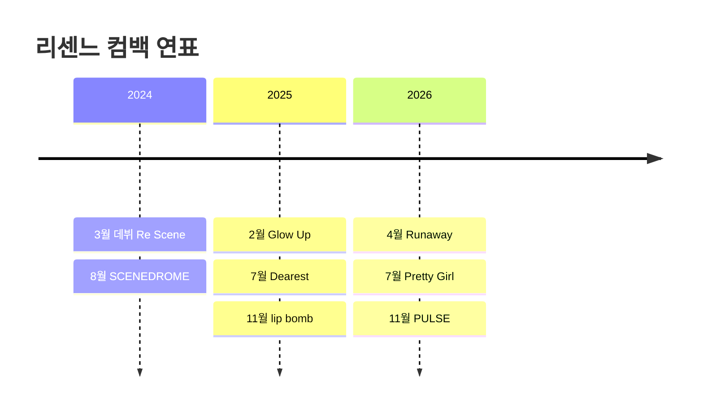

# 활동 연표

## 개요

리센느의 발매와 무대를 연도 순으로 모은 길잡이 노트다. 연도 노트는 [[2024년 활동]], [[2025년 활동]], [[2026년 활동]]이고, 한 장짜리 그림은 아래 캔버스에서 본다.

## 컴백 타임라인

![[컴백 타임라인.canvas]]

캔버스는 데뷔부터 [[PULSE]]까지 앨범 노트를 시간순 가로로 놓았다. 노드를 더블클릭하면 해당 노트가 열린다.

## 한눈에 보는 연표

위 그림은 이 볼트에서 직접 그린 것이다. 발매일 근거는 각 앨범 노트의 각주에 있다.[^1][^2][^3]

## 관련 문서

- [[리센느]]
- [[둘러보기 길잡이]]

[^1]: [위키백과 「리센느」](https://ko.wikipedia.org/wiki/%EB%A6%AC%EC%84%BC%EB%8A%90), 2026-11-06 확인
[^2]: [나무위키 「RESCENE」](https://namu.wiki/w/RESCENE), 2026-11-06 확인
[^3]: [kprofiles 「RESCENE Discography」](https://kprofiles.com/rescene-discography/), 2026-11-06 확인
